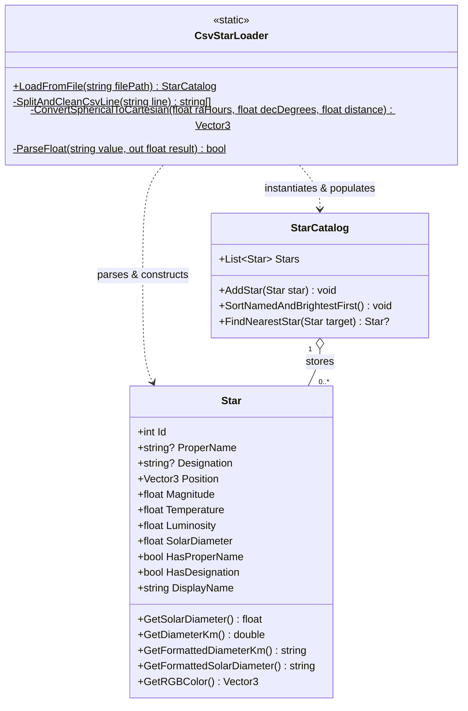

# Advanced Software Engineering
## Semester 1 2026

Fill in your details and get them correct, delete this line when done. Correctly filling in ReadMe.md is generously part of the marking scheme!
# Name: Alfie Lea
# Group: 1
# Course: Computer Science

### [YouTube Demo Link for Assignment1](https://insertYourLinkHere)

### [YouTube Demo Link for Assignment2](https://insertYourLinkHere)

Feel free to delete any of the information below to tidy up your readme, but do not delete the above information as it is used for marking and do not delete any files in the repo as some are used for building documentation for your assignments.

[Details on how to create a project in these repo directories.](https://github.com/LeedsBeckettUniversityASE/ASEresources/blob/main/VisualStudioProjects.md)

## Assignments

You must be logged into myBeckett to view the assignment spec. Sync your browswer with your LBU account.

[Assignment Specification](https://leedsbeckett-my.sharepoint.com/:b:/g/personal/d_mullier_leedsbeckett_ac_uk/IQAfMN9DgVEdQJIvbNKtkIhCAe4herw6o4nj_Iun4tXZeNU?e=JiytOR)

**See The Assignment Specification for assignment dates**. They are not repeated here becuase software engineers do not repeat things as this leads to bugs.
### [Useful Links for the Assignments](https://github.com/LeedsBeckettUniversityASE/ASEresources/blob/main/UsefulLinks.md).
These links are likely to be updated as more information is added, so check reqularly.
## Assignment 1: AI Programming 3D Star Chart
See the assignment spec for details. You are expected to implement a 3D star chart using AI programming techniques. The star chart should allow users to visualise stars in a three-dimensional space, with features such as zooming, rotating and filtering based on star properties.

You must explain your code in your demo or you will be asked to do it again/a live demo.

Edit the YouTube Link above, the part in the square brackets is the text you see and doesn't need to change. Put the url of your demo inside the round brackets and check it clicks through to your demo.
### Ai Approach
This project was developed using an iterative, human-in-the-loop AI-assisted software engineering workflow. Rather than relying on monolithic code generation, the architecture was decomposed into decoupled modules—data ingestion (CsvStarLoader), astrophysical modeling (Star, StarCatalog), GPU rendering (StarRenderer and Shader), camera navigation (Camera), and interface controls (UIManager). Generative AI was utilised as a collaborative pair-programming tool to accelerate boilerplate scaffolding, GLSL shader prototyping, and UI layout iteration, while all core mathematical models (such as Stefan-Boltzmann stellar radius scaling and Ballesteros' temperature approximations), OpenGL state management, and architectural boundaries were manually verified, debugged, and incrementally integrated to maintain codebase stability.

### Data Layer Class Structure

The core data architecture (`namespace StarChart`) separates astronomical entity modeling, collection management, and file ingestion into three cohesive classes.

#### Class Relationships

---

### 1. `Star`
Represents an individual astronomical body and encapsulates physical derivations (Stefan-Boltzmann scaling, blackbody colour temperature) and UI display formatting.

#### Properties
| Member | Type | Access | Description |
| :--- | :--- | :--- | :--- |
| `Id` | `int` | `get; set;` | Unique catalog identifier from the HYG dataset (`0` = Sol). |
| `ProperName` | `string?` | `get; set;` | Common human name (e.g., *Sirius*, *Betelgeuse*), if cataloged. |
| `Designation` | `string?` | `get; set;` | Fallback astronomical identifier (Bayer/Flamsteed, Gliese, HR, HD, or HIP). |
| `Position` | `Vector3` | `get; set;` | Heliocentric 3D Cartesian coordinates in light-years/parsecs. |
| `Magnitude` | `float` | `get; set;` | Apparent visual magnitude (`mag`). |
| `Temperature` | `float` | `get; set;` | Effective surface temperature in Kelvin (`1,000 K` – `40,000 K`). |
| `Luminosity` | `float` | `get; set;` | Bolometric luminosity relative to the Sun ($L / L_\odot$). |
| `SolarDiameter` | `float` | `get;` | Computed diameter ratio relative to Sol ($1.0\text{ R}_\odot$). |
| `HasProperName` | `bool` | `get;` | `true` if `ProperName` is non-empty. |
| `HasDesignation` | `bool` | `get;` | `true` if `Designation` is non-empty. |
| `DisplayName` | `string` | `get;` | Resolves display priority: `ProperName` $\rightarrow$ `Designation` $\rightarrow$ `Star #{Id}`. |

#### Methods
| Signature | Return Type | Description |
| :--- | :--- | :--- |
| `GetSolarDiameter()` | `float` | Computes stellar radius/diameter ratio relative to Sol ($T_\odot = 5778\text{ K}$) via $\sqrt{L/L_\odot} \cdot (T_\odot / T)^2$. |
| `GetDiameterKm()` | `double` | Converts `SolarDiameter` to absolute kilometres ($1\text{ R}_\odot = 1,392,700\text{ km}$). |
| `GetFormattedDiameterKm()` | `string` | Formats kilometre diameter with readable scale suffixes (`km`, `Million km`, `Billion km`, `Trillion km`). |
| `GetFormattedSolarDiameter()` | `string` | Formats relative solar size with adaptive decimal precision (`R⊙`). |
| `GetRGBColor()` | `Vector3` | Approximates normalized RGB colour (`0.0`–`1.0`) from `Temperature` using Tanner Helland's blackbody algorithm. |

---

### 2. `StarCatalog`
Manages the in-memory collection of loaded `Star` instances and provides sorting and spatial query operations.

#### Properties
| Member | Type | Access | Description |
| :--- | :--- | :--- | :--- |
| `Stars` | `List<Star>` | `get;` | Backing list containing all valid stars parsed from the dataset. |

#### Methods
| Signature | Return Type | Description |
| :--- | :--- | :--- |
| `AddStar(Star star)` | `void` | Appends a parsed `Star` instance to the catalog. |
| `SortNamedAndBrightestFirst()` | `void` | Orders stars with proper human names first, sorting ties and remaining stars by ascending apparent magnitude. |
| `FindNearestStar(Star target)` | `Star?` | Performs a linear squared-distance search (`Vector3.DistanceSquared`) to locate the closest neighbour to `target`. |

---

### 3. `CsvStarLoader` (`static`)
Handles file resolution, transparent GZip decompression, CSV sanitization, and coordinate/astrophysical parsing for the HYG catalog.

#### Methods
| Signature | Visibility | Description |
| :--- | :--- | :--- |
| `LoadFromFile(string filePath)` | `public` | Resolves `filePath` (checking working directory, base directory, and `Assets/`), streams plain `.csv` or `.csv.gz` data, maps dynamic column headers, and returns a populated `StarCatalog`. |
| `SplitAndCleanCsvLine(string line)` | `private` | Splits comma-delimited rows and strips outer quotes, whitespace, newlines, and UTF-8 BOM (`\uFEFF`) characters. |
| `ConvertSphericalToCartesian(...)` | `private` | Fallback converter transforming Right Ascension (`ra` in hours), Declination (`dec` in degrees), and `dist` into 3D `Vector3` coordinates. |
| `ParseFloat(string value, out float result)` | `private` | Culture-invariant (`CultureInfo.InvariantCulture`) floating-point parser. |

## Assignment 2: BOOSE Programming Language interpreter
See the assignment spec for details. You are expected to implement an interpreter for the BOOSE programming language. The interpreter should be able to parse and execute BOOSE code, handling various constructs such as variables, loops, conditionals, and functions.

You must explain your code in your demo or you will be asked to do it again/a live demo.

Edit the YouTube Links above, the part in the square brackets is the text you see and doesn't need to change. Put the url of your demo inside the round brackets and check it clicks through to your demo.

# Submitting Assignments
This applies to **both** assignments.

**You MUST do all of these steps or you will lose marks**. All details are in the **Assignment Specification**.

Apologies if this all seems a bit patronising but every year I get a handful who take longer to process than everyone else combined because they don't read instructions.
### All code must be part of the Classroom50 Classroom, using the this template repo. You should not commit after the deadline.
### You must provide a YouTube Demo that is uploaded as public but unlistable and the link must be provided in this README.md file above (edit the link). 
The demo should showcase the functionality of your assignments and demonstrate your understanding of the code. You must use a microphone and explain your code. 
See Assignment Specification and [YouTube demo software document](https://github.com/LeedsBeckettUniversityASE/ASEresources/blob/main/Recording_A_YouTube_Demo.md)
### You MUST submit links to your video, repo and upload your source code directory to **myBeckett**, this is the official submission that records your hand in time, 
If you do not do this on time it is officially not handed in/late.

[University's Flexible Submission Policy](https://drive.google.com/file/d/108-9vWaaakjDZKFBI6SffSGaSzmYbNJk/view?usp=sharing)

[University's Extenuating Circumstance Policy](https://www.leedsbeckett.ac.uk/student-information/exams-assessments-and-awards/mitigation-and-extenuating-circumstances/)

**Module Leaders cannot give out extensions, so don't ask, instead click the above link**

